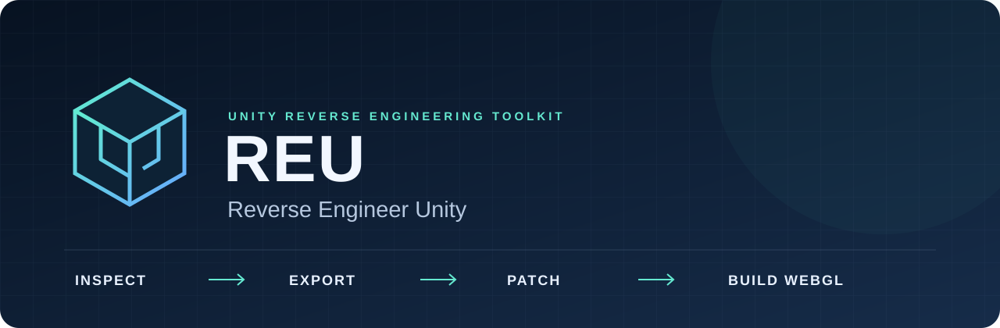
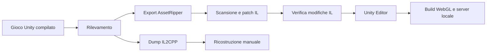

<div align="center">

[English](README.md) · **Italiano**

# REU: Reverse Engineer Unity

### Analizza giochi Unity compilati. Recupera asset. Adatta codice managed verso WebGL.



[](https://github.com/Luinseng/REU/actions/workflows/ci.yml)
[](#requisiti)
[](#requisiti)
[](LICENSE)
[](#stato-e-verifiche)

[Avvio rapido](#avvio-rapido) · [Funzionamento](#funzionamento) · [Compatibilità](#compatibilità) · [Limiti](#limiti) · [Documentazione](#documentazione)

</div>

REU è un harness locale sperimentale per analizzare giochi Unity compilati, recuperare una struttura di progetto, studiare gli assembly managed e tentare una build Unity WebGL. Riunisce una CLI Python, strumenti esterni, un patcher IL in .NET e componenti runtime per Unity.

Per i giochi **Mono**, l'esportazione predefinita conserva gli assembly compilati e adatta alcune API incompatibili con il browser. Per **IL2CPP**, produce dump e materiale di riferimento: la ricostruzione della logica rimane manuale.

Il nome pubblico è **REU — Reverse Engineer Unity**. I nomi `u2w.py`, `unity2web` e `Unity2Web.*` restano nei comandi e nel codice per compatibilità.

> [!IMPORTANT]
> Un progetto esportato o una build riuscita non dimostrano che un gioco sia giocabile o equivalente alla versione desktop. Scene, rendering, input, audio, salvataggi, rete e prestazioni richiedono verifiche separate.

## Avvio rapido

Clona il repository e controlla l'ambiente:

```powershell
git clone https://github.com/Luinseng/REU.git
cd REU
python u2w.py doctor
```

Analizza il gioco prima di esportarlo:

```powershell
python u2w.py detect "D:\Games\MioGiocoUnity" --json
```

Prepara gli strumenti per Mono:

```powershell
python u2w.py tools assetripper patcher shims ilverify
```

Il comando scarica gli strumenti fissati e compila patcher e shim. Richiede internet e ripristino NuGet. `python u2w.py tools` tenta anche tutti gli strumenti opzionali. Leggi gli avvisi e ricontrolla con `doctor`.

Con Editor Unity corrispondente, modulo WebGL e licenza valida:

```powershell
python u2w.py port "D:\Games\MioGiocoUnity" --work "work\mio-gioco" --serve
```

`port` esegue rilevamento, esportazione, patch, verifica IL, build, packing opzionale e compressione. Se riesce, apre la build su `http://127.0.0.1:8080/`. Il percorso normale si ferma sui casi IL2CPP o bloccati.

## Requisiti

| Componente | Requisito |
| --- | --- |
| Sistema | Windows è il target attuale. Il manifest seleziona eseguibili Windows; il flusso completo macOS/Linux non è verificato. |
| Python | Python 3.13, verificato localmente e selezionato in CI. I comandi principali usano la libreria standard. |
| .NET | **SDK .NET 10**: patcher e runner usano `net10.0`. .NET 8 da solo non basta. |
| Unity | Editor della versione del gioco, **WebGL Build Support** e licenza valida per compilare. |
| Brotli opzionale | `python -m pip install brotli` abilita lettura Brotli e output `.br`. Gzip non richiede altri pacchetti. |
| Risorse | Export, importazione e compilazione possono richiedere molto spazio, RAM e tempo. |

## Funzionamento



1. **Rilevamento:** versione, backend, piattaforma e dipendenze riconosciute.
2. **Esportazione:** recupero di asset e struttura tramite AssetRipper. Con Mono, la modalità predefinita conserva le DLL managed.
3. **Scansione e patch:** Mono.Cecil identifica incompatibilità e riscrive chiamate selezionate, conservando originali e report.
4. **Verifica:** ILVerify confronta i risultati con gli originali per individuare problemi introdotti dalle patch.
5. **Build:** il progetto riceve bootstrap, helper, builder e template; compila l'Editor selezionato.
6. **Server locale:** packing opzionale di StreamingAssets, compressione e header WebGL.

Il risultato è un progetto ricostruito da artefatti compilati. Non è il progetto di sviluppo originale né il suo codice sorgente originale.

## Compatibilità

| Caso | Verdetto | Significato |
| --- | --- | --- |
| Mono | `AUTO` | Il percorso automatico esiste; possono servire correzioni specifiche. |
| IL2CPP | `MANUAL` | Asset e riferimenti aiutano lo studio; la logica mancante va ricostruita. |
| HDRP o versioni Unity meno recenti non supportate | `BLOCKED` | La pipeline attuale non produce direttamente il risultato WebGL richiesto. |
| Build già WebGL | `ALREADY-WEB` | Il pacchetto si può ispezionare o estrarre. |

REU offre scansione assembly, patch IL, decompilazione managed di riferimento, dump IL2CPP, helper runtime, builder batch e gestione dei pacchetti WebGL. Il server gestisce MIME type, compressione, range request e COOP/COEP opzionali.

### Procedura passo per passo

```powershell
python u2w.py export "D:\Games\MioGiocoUnity" --work "work\mio-gioco"
python u2w.py scan "work\mio-gioco"
python u2w.py patch --work "work\mio-gioco" --rules rules.example.json
python u2w.py verify --work "work\mio-gioco"
python u2w.py build --work "work\mio-gioco" --development
python u2w.py serve "work\mio-gioco" --open
```

### IL2CPP e pacchetti WebGL

```powershell
python u2w.py tools cpp2il il2cppdumper
python u2w.py il2cpp "D:\Games\MioGiocoIL2CPP" --work "work\studio-il2cpp"
python u2w.py unpack-webgl "D:\Builds\MiaBuildWebGL"
python u2w.py unpack-webgl "D:\Builds\MiaBuildWebGL" --out "work\estratto"
```

Dummy DLL, firme e rappresentazioni intermedie IL2CPP non contengono un'implementazione completa dei metodi originali.

### Uso con un agente AI

Un agente con accesso al terminale può usare la CLI. Esempio:

```text
Usa REU per analizzare il mio gioco autorizzato in D:\Games\MioGiocoUnity.
Esegui prima detect, spiega le incompatibilità e salva il lavoro in work\mio-gioco.
Controlla report e patch prima di tentare la build WebGL.
Distingui compilazione, verifica nel browser e risultati del gameplay.
```

Il repository espone una CLI e un server HTTP locale. Non include un server MCP.

## Limiti

- Un export può perdere asset, scene o riferimenti. L'ordine delle scene può richiedere correzioni.
- IL2CPP non viene trasformato automaticamente in C# completo e funzionante.
- Le DLL native desktop non funzionano in WebGL. Uno stub Steamworks non mantiene servizi Steam, autenticazione o multiplayer.
- Le patch ai thread cambiano il comportamento temporale. Worker infiniti possono bloccare il browser; controlla `skipThreadBodies`.
- Socket TCP/UDP e trasporti desktop richiedono un'implementazione browser o un relay.
- HDRP, shader personalizzati, middleware audio/video e funzioni della piattaforma possono richiedere interventi manuali.
- Il limite predefinito del packing è 1024 MB. Pacchetti grandi aumentano la memoria iniziale; asset non impacchettati possono richiedere caricamento HTTP asincrono.
- Salvataggi e persistenza vanno provati nel browser. I template non dimostrano compatibilità completa con ogni versione Unity.

## Stato e verifiche

**Pubblicazione sorgente sperimentale.** La compatibilità dipende dal gioco, dalla versione del motore, dagli asset e dalle dipendenze.

Durante questa pubblicazione, la suite ha completato **22 test senza salti** su Windows, Python 3.13.11 e SDK .NET 10.0.300, con assembly Unity installati. Include esecuzione del gioco sintetico patchato e compilazione dei componenti C# contro gli assembly di un Editor installato.

GitHub Actions verifica Python e integrazione .NET. Non installa Unity: il controllo che richiede gli assembly dell'Editor viene normalmente saltato. Questi test non costituiscono una build WebGL completa, una prova del rendering o un'accettazione del gameplay.

## Struttura

```text
u2w.py                     Entry point CLI esistente
unity2web/                 Orchestrazione Python
dotnet/Unity2Web.Patcher/   Scanner e patcher IL Mono.Cecil
dotnet/Unity2Web.Shims/     Helper managed net35
dotnet/Tests/              Fixture sintetiche e runner
unity/Unity2Web/           Bootstrap, bridge WebGL e builder
unity/WebGLTemplates/      Template moderni e legacy
tests/                     Test unitari, integrazione e fixture Unity
docs/                      Guide, verifiche, ricerca e banner
tools.json                 Manifest degli strumenti esterni
rules.example.json         Esempio commentato delle regole
tools/                     Download locali esclusi da Git
work/                      Export, report e build privati esclusi da Git
```

## Domande frequenti

<details>
<summary><strong>REU è un emulatore o un remake?</strong></summary>

No. Tenta di ricostruire un progetto e usare il compilatore WebGL di Unity. Con Mono riutilizza gli assembly managed quando possibile, applicando adattamenti runtime.

</details>

<details>
<summary><strong>Un gioco che compila è già funzionante?</strong></summary>

No. Vanno provati caricamento, grafica, controlli, audio, salvataggi, scene, rete e prestazioni.

</details>

<details>
<summary><strong>Il gioco viene caricato online?</strong></summary>

Analisi e build sono locali. Download e servizi Unity/NuGet possono usare internet. Un agente AI segue anche le regole del proprio fornitore.

</details>

<details>
<summary><strong>Il repository contiene giochi o tool eseguibili?</strong></summary>

No. Contiene harness, documentazione e piccole fixture originali. Download e cartelle dei giochi restano fuori Git.

</details>

## Documentazione

- [Guida d'uso e comandi, in inglese](docs/USAGE.md)
- [Test e confini delle verifiche, in inglese](docs/TESTING.md)
- [Ricerca originale e progetti correlati](docs/RICERCA.md)
- [Contribuire](CONTRIBUTING.md)
- [Strumenti e dipendenze esterne](THIRD_PARTY_NOTICES.md)
- [Segnalare un problema](https://github.com/Luinseng/REU/issues)

La presentazione si ispira a [REA — Reverse Engineer Anything](https://github.com/morluto/rea). REU è indipendente, focalizzato su Unity: non include REA e non ne eredita le funzioni.

## Licenza e uso autorizzato

Codice e documentazione propri di REU usano la [licenza MIT](LICENSE). Gli strumenti esterni mantengono i propri termini: consulta [THIRD_PARTY_NOTICES.md](THIRD_PARTY_NOTICES.md).

Usa REU su software che sei autorizzato ad analizzare e adattare. La licenza del tool non concede diritti su codice, asset, middleware o Unity. Distribuisci output derivati dai giochi solo con le necessarie autorizzazioni. Unity è un marchio di Unity Technologies; REU è indipendente.
