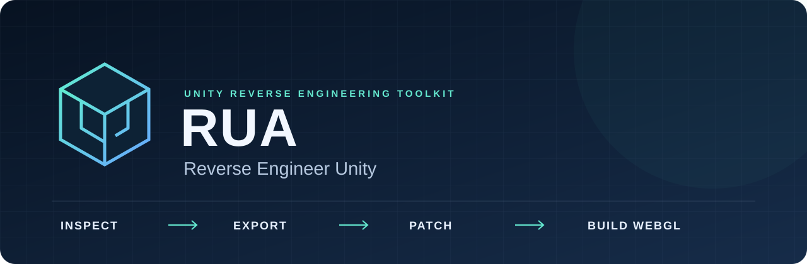
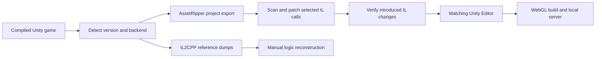

<div align="center">

**English** · [Italiano](README.it.md)

# RUA: Reverse Engineer Unity

### Inspect compiled Unity games. Recover assets. Adapt managed code toward WebGL.



[](https://github.com/Luinseng/RUA/actions/workflows/ci.yml)
[](#requirements)
[](#requirements)
[](#requirements)
[](LICENSE)
[](#current-status)

[Quick start](#quick-start) · [How it works](#how-it-works) · [Capabilities](#capabilities) · [Examples](#examples) · [Limits](#limits) · [FAQ](#faq)

`python u2w.py doctor`

</div>

RUA is an experimental local harness for inspecting compiled Unity games, recovering a project structure, analyzing managed assemblies, and attempting a native Unity WebGL build. It connects a Python CLI, external reverse engineering tools, a .NET IL patcher, and Unity runtime helpers in one repeatable workspace.

For **Mono games**, the default export path keeps compiled managed assemblies and patches selected APIs that cannot work unchanged in a browser. For **IL2CPP games**, RUA prepares reference dumps for manual investigation; it does not reconstruct complete original C# logic.

The public name is **RUA — Reverse Engineer Unity**. The existing `u2w.py`, `unity2web`, and `Unity2Web.*` names remain in source and commands for compatibility.

> [!IMPORTANT]
> An exported project or successful build does not establish that a game is playable or equivalent to its desktop version. Validate scenes, rendering, input, audio, saves, networking, and performance separately.

## Quick start

### 1. Clone and check the environment

```powershell
git clone https://github.com/Luinseng/RUA.git
cd RUA
python u2w.py doctor
```

### 2. Inspect a game before exporting

```powershell
python u2w.py detect "D:\Games\MyUnityGame" --json
```

Detection reports the Unity version, Mono or IL2CPP backend, platform, middleware markers, and a preliminary compatibility verdict. The verdict is a planning aid, not a gameplay result.

### 3. Prepare the Mono toolchain

```powershell
python u2w.py tools assetripper patcher shims ilverify
```

This downloads the pinned tools needed by this workflow and compiles RUA's patcher and shims. Downloads require internet access; .NET restores packages from NuGet. Use `python u2w.py tools` to attempt all manifest tools, including IL2CPP and decompilation tools. Read installer warnings and run `doctor` afterward.

### 4. Attempt a WebGL port

With the matching licensed Unity Editor and WebGL Build Support installed:

```powershell
python u2w.py port "D:\Games\MyUnityGame" --work "work\my-game" --serve
```

The command runs detection, export, patching, IL verification, Unity building, optional StreamingAssets packing, and compression. If successful, it serves output at `http://127.0.0.1:8080/` and opens the browser. IL2CPP and blocked inputs stop the normal automated path.

Use the [staged workflow](docs/USAGE.md) to inspect reports or adjust patches between stages.

## Requirements

| Component | Requirement |
| --- | --- |
| Host | Windows is the current target. The manifest selects Windows binaries; complete macOS/Linux workflows are not verified. |
| Python | Python 3.13 is tested locally and selected in CI. Core commands use the standard library. Other versions are not covered by published CI. |
| .NET | **.NET 10 SDK**. The patcher and integration runner target `net10.0`; .NET 8 alone is insufficient. |
| Unity | The game's matching Editor, **WebGL Build Support**, and a valid Unity license are required for building. Detection, packing, and serving do not require an Editor build. |
| Optional Brotli | `python -m pip install brotli` enables Brotli package reading and `.br` output. Gzip needs no extra package. |
| Resources | Export, asset import, and WebGL compilation may require substantial disk space, RAM, and time. |

RUA can list installed Editors and request installation through Unity Hub. Installation and license activation remain subject to Unity's requirements.

## How it works



1. **Detect:** identify engine version, scripting backend, render pipeline, and dependency markers.
2. **Export:** ask AssetRipper to recover assets and project structure. Default Mono mode retains managed DLLs instead of building from decompiled C#.
3. **Scan and patch:** report incompatible APIs and rewrite selected calls with Mono.Cecil. Keep original assemblies and emit patch reports.
4. **Verify:** compare ILVerify findings against originals to identify findings introduced by patching.
5. **Build:** inject Unity runtime and Editor helpers, then invoke the selected Editor's WebGL pipeline.
6. **Package and serve:** optionally pack StreamingAssets into the `.data` file, generate compressed sidecars, and serve locally.

The result is a reconstruction from compiled artifacts. It is not the original development project or original source code.

## Capabilities

| Area | Implemented behavior | Practical boundary |
| --- | --- | --- |
| Unity inspection | Detect version and backend from folders, executables, APK inputs, and WebGL builds | Input recognition does not guarantee a usable export. |
| Mono assemblies | DLL export, API scanning, IL rewriting, optional ILSpy C# output | Decompiled C# is reference material and may not compile. |
| IL2CPP | Il2CppDumper and Cpp2IL reference output, dummy assemblies and intermediate representations | Signatures and dumps are not recovered game logic. |
| Native dependencies | Stub selected imports or relink specified libraries to `__Internal` | Stubs remove functionality; real support needs a compatible implementation. |
| Runtime adaptation | Helpers for selected thread, path, folder, process, URL, and persistence behavior | Rewrites change semantics and need per-game testing. |
| Unity projects | Bootstrap injection, assembly renaming, plugin relocation, templates and batch builder | Scenes, shaders, plugins, and serialized references may need repairs. |
| WebGL packages | List/extract UnityWebData, pack StreamingAssets, gzip and optional Brotli | Large packages increase startup memory use. |
| Local hosting | MIME types, compression, range requests, optional COOP/COEP | HTTP success does not validate gameplay or multiplayer. |

### Compatibility verdicts

| Case | Normal path | Meaning |
| --- | --- | --- |
| Mono | `AUTO` candidate | Automation exists; project-specific fixes may still be necessary. |
| IL2CPP | `MANUAL` | Export assets and references, then reconstruct missing logic manually. |
| HDRP or unsupported older Unity versions | `BLOCKED` | The current pipeline cannot directly produce the expected WebGL result. |
| Existing WebGL build | `ALREADY-WEB` | Inspect or extract with `unpack-webgl`. |

## Examples

### Inspect the project between stages

```powershell
python u2w.py export "D:\Games\MyUnityGame" --work "work\my-game"
python u2w.py scan "work\my-game"
python u2w.py patch --work "work\my-game" --rules rules.example.json
python u2w.py verify --work "work\my-game"
python u2w.py build --work "work\my-game" --development
python u2w.py serve "work\my-game" --open
```

### Generate IL2CPP references

```powershell
python u2w.py tools cpp2il il2cppdumper
python u2w.py il2cpp "D:\Games\MyIL2CPPGame" --work "work\il2cpp-study"
```

These outputs support manual investigation. They do not implement the original methods.

### Inspect an existing WebGL package

```powershell
python u2w.py unpack-webgl "D:\Builds\MyWebGLGame"
python u2w.py unpack-webgl "D:\Builds\MyWebGLGame" --out "work\unpacked"
```

### Use RUA with a coding agent

An agent with terminal access can call the CLI. Example:

```text
Use this local RUA checkout to inspect my authorized Unity game at D:\Games\MyUnityGame.
Run detection first and explain the findings. Save exports in work\my-game.
Review scan and patch reports before attempting the WebGL build.
Keep build results, browser checks, and gameplay findings separate.
```

RUA exposes a CLI and a local HTTP build server. An MCP server is not part of this repository.

## Limits

- **Assets and scenes:** exports can omit unreadable assets or produce an incomplete project. Scene order and serialized references need inspection.
- **IL2CPP:** the Mono path cannot restore machine code to complete original C# methods.
- **Native plugins:** desktop DLLs do not run in WebGL. Stubbed Steamworks calls do not preserve services, achievements, authentication, or networking.
- **Threading:** main-thread adaptations change timing. Infinite workers can freeze the browser; review scanner findings and `skipThreadBodies`.
- **Networking:** raw TCP/UDP, peer-to-peer libraries, and desktop transports need a browser-compatible implementation or relay.
- **Rendering and media:** HDRP, custom shaders, native audio/video middleware, and platform effects can need manual adaptation. Export modes do not establish complete shader recovery.
- **Memory and files:** StreamingAssets packing defaults to a 1024 MB limit. Large packages affect startup memory. Unpacked assets may need asynchronous HTTP loading; persistence needs browser testing.
- **Editor versions:** version-specific helpers and templates exist, but successful builds across every supported Unity line are not established.

## Current status

**Experimental source release.** Compatibility depends on the input game, engine version, assets, and platform dependencies.

For this publication, the existing suite completed **22 tests with no skips** on Windows, Python 3.13.11 and .NET SDK 10.0.300, with installed Unity assemblies. This includes fake-game IL patch execution and compilation of injected C# against an installed Editor's assemblies.

[GitHub Actions](.github/workflows/ci.yml) runs Python and .NET integration checks. It does not install Unity, so the Editor-dependent check normally skips there. These results are separate from a licensed WebGL build, browser rendering, and gameplay acceptance. See [testing](docs/TESTING.md).

## Project layout

```text
u2w.py                     Existing CLI entry point
unity2web/                 Python detection, export, build, packaging and serving
dotnet/Unity2Web.Patcher/   Mono.Cecil scanner and IL patcher
dotnet/Unity2Web.Shims/     Managed runtime helpers targeting net35
dotnet/Tests/              Synthetic game and patch execution fixtures
unity/Unity2Web/           Runtime, WebGL bridge and Editor builder
unity/WebGLTemplates/      Modern and legacy WebGL templates
tests/                     Unit, integration and optional Unity checks
docs/                      Usage, validation, research notes and visual assets
tools.json                 Pinned external tools
rules.example.json         Commented patch rules
tools/                     Downloaded tools; excluded from Git
work/                      Private exports, reports and builds; excluded from Git
```

## FAQ

<details>
<summary><strong>Is RUA an emulator or a remake?</strong></summary>

No. It attempts to reconstruct a Unity project and use Unity's WebGL compiler. The Mono path reuses compiled managed assemblies where possible, with runtime adaptations.

</details>

<details>
<summary><strong>Can it recover the original project and C# source?</strong></summary>

It recovers structure and assets through external tools and can decompile managed assemblies for reference. Results remain reconstructed artifacts. IL2CPP references do not recover complete original method implementations.

</details>

<details>
<summary><strong>Does a successful build mean the game works?</strong></summary>

No. Test loading, rendering, controls, audio, save/reload, scene transitions, networking, and performance in real browsers.

</details>

<details>
<summary><strong>Does RUA upload my game?</strong></summary>

Target analysis and building run locally. Downloads and Unity/NuGet services may use the network. An AI agent's model provider has separate data handling rules.

</details>

<details>
<summary><strong>Are games or executable third-party tools included?</strong></summary>

No. The repository contains the harness, documentation, and small original fixtures. Downloads and game workspaces stay outside Git. External tools retain their own licenses.

</details>

## Documentation and contributing

- [Usage and command reference](docs/USAGE.md)
- [Testing and validation boundaries](docs/TESTING.md)
- [Original research notes, in Italian](docs/RICERCA.md)
- [Contributing](CONTRIBUTING.md)
- [Third-party tools and notices](THIRD_PARTY_NOTICES.md)
- [Report a reproducible issue](https://github.com/Luinseng/RUA/issues)

README presentation is inspired by [REA — Reverse Engineer Anything](https://github.com/morluto/rea). RUA is an independent Unity-focused project; it does not bundle REA or inherit its capabilities.

## License and authorized use

RUA-authored code and documentation use the [MIT License](LICENSE). External tools and dependencies retain their own terms; see [third-party notices](THIRD_PARTY_NOTICES.md).

Use RUA with software you are authorized to examine and adapt. This license grants no rights to third-party game code, assets, middleware, or Unity. Distribute game-derived outputs only with the necessary permission. Unity is a trademark of Unity Technologies; RUA is independent.
